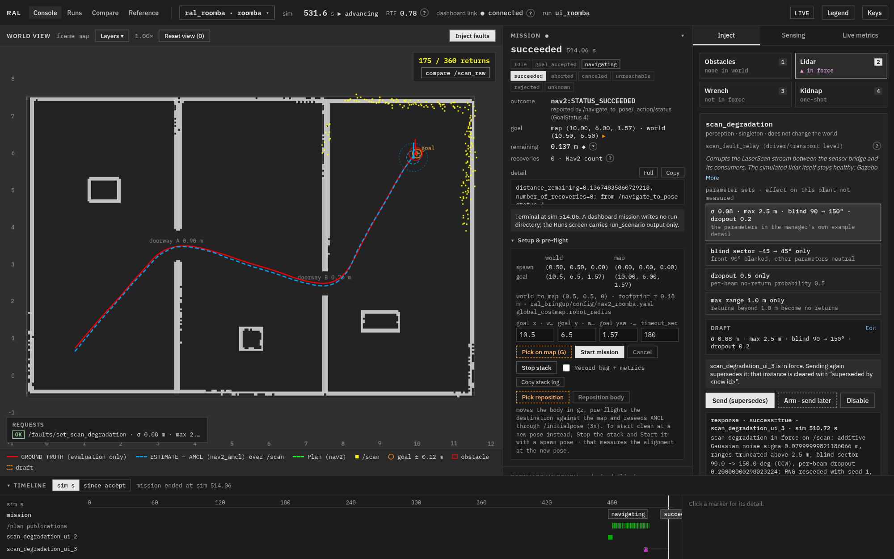
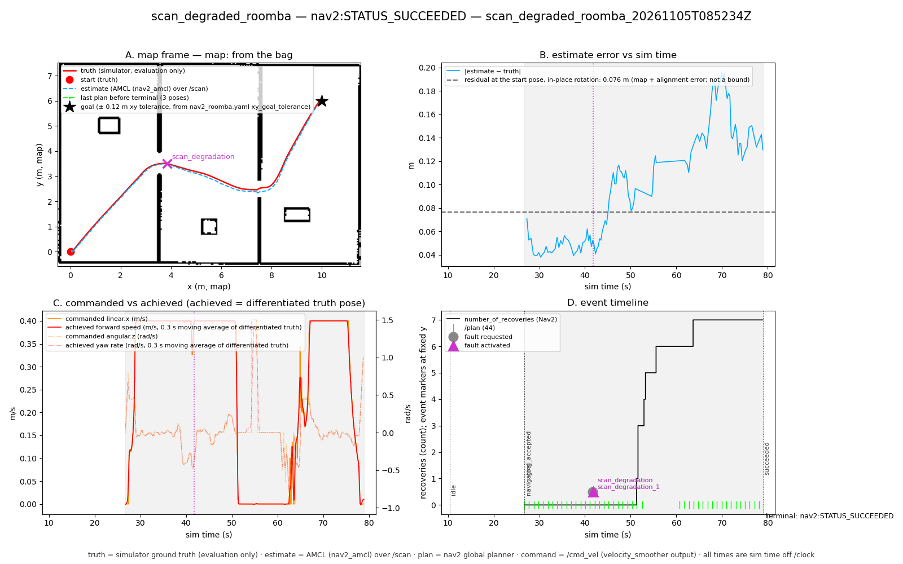
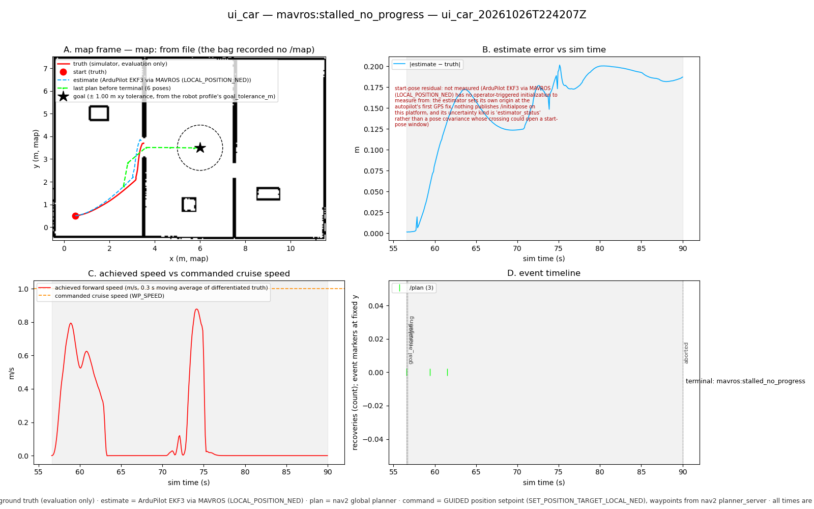
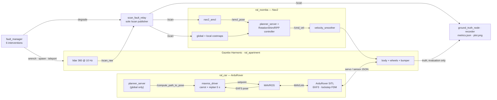

# Resilient Autonomy Lab

**Two genuinely different ground robots, each driven by a real autonomy stack,
navigating a simulated apartment while an operator breaks things mid-mission.**

Every figure below was produced by a harness in this repository and names the
artifact it came from. Where something does not work, it says so and gives the
measurement.

## What works today

| | `ral_roomba` | `ral_car` |
| --- | --- | --- |
| **Body** | differential drive, 0.18 m disc, turns in place | Ackermann, 0.50 × 0.30 m, 0.611 m minimum turning radius, cannot turn in place |
| **Autonomy** | **Nav2** — global planner + `RotationShimController` wrapping `RegulatedPurePursuitController` | **ArduRover SITL** over MAVLink/MAVROS in GUIDED mode, fed waypoints by Nav2's global planner only |
| **Localization** | **AMCL** over `/scan`, against a map `slam_toolbox` built from the robot's own lidar | **ArduPilot EKF3** (IMU + SITL GPS) read over MAVROS; EKF origin measured per run, never assumed |
| **Commanded by** | `/cmd_vel` velocity twist (velocity smoother output) | `SET_POSITION_TARGET_LOCAL_NED` position setpoints |
| **Obstacle avoidance** | global + local costmaps, Nav2 recoveries | **none** — global replanning every 5 s sim, nothing reactive in between |
| **Interventions** | 6 of 6 | 6 of 6 — but `scan_degradation` reaches only this platform's global costmap; the autopilot's control loop never reads the lidar, and the profile says so verbatim when the fault activates |
| **Measured result** | reaches a goal through a 0.70 m doorway, 0.03–0.11 m from it, 0 collisions | completes a straight corridor (8 of 9 runs, 0.55 m error); plans a turning route and follows it, then wedges in a 0.9 m doorway and ends `mavros:stalled_no_progress` |

Simulator: Gazebo Harmonic, ROS 2 Humble, one authored world (`ral_apartment`).
Real-time factor 0.999–1.002 at the selected physics and lidar settings
([`docs/gate.md`](docs/gate.md)); ArduPilot runs in lockstep with the physics
clock, so every duration in the evidence is sim time off `/clock`.



*Live console, captured 2026-11-05 against a running stack. Red is simulator
ground truth, blue dashed is what AMCL believes, green dashed is the Nav2 plan,
yellow is `/scan` **as its consumers see it** — 159 of 360 beams returning,
because a lidar fault is in force. The right-hand panel is the fault manager's
verbatim response (σ 0.08 m additive noise, 2.5 m truncation, a 90°–150° blind
sector, 0.2 per-beam dropout, RNG reseeded with seed 1), not a UI label. The
mission still finished: `nav2:STATUS_SUCCEEDED`, 0.137 m from the goal.*

## Three results worth reading

### 1. A sensor fault reaches the estimator, and the robot copes visibly



`scan_degraded_roomba`, run `20261105T085234Z`, generated by
`scripts/run_scenario.sh scan_degraded_roomba`. Lidar degradation is injected at
**41.73 s sim** into a mission that is otherwise the baseline:

| | baseline (3 runs) | this run |
| --- | --- | --- |
| `est_error_mean_m` (AMCL vs truth) | 0.069–0.073 | **0.099** |
| `est_error_max_m` | — | **0.196** |
| Nav2 `recoveries` | 0, 0, 0 | **7** |
| `stopped_time_s` | — | **7.97** |
| `mission_duration_s` | 37.06–37.62 | **52.22** |
| outcome | `nav2:STATUS_SUCCEEDED` | `nav2:STATUS_SUCCEEDED`, 0.068 m from goal, 0 collisions |

The fault is proven at the wire, not asserted: `/scan` is compared against
`/scan_raw` **beam by beam on identical header stamps** — 729 sweeps matched,
**0 divergent before activation**, first divergence at 41.80 s, 0.06 s after the
fault manager reported it active. One relay publishes `/scan`, so every
consumer — AMCL and both costmaps — is downstream of the injection by
construction.

### 2. The car fails where its design says it should, and the failure is legible



`ral_car`, run `ui_car_20261026T224207Z`. The planner returns a feasible route
around wall A and the vehicle tracks it out of the open room — then wedges in a
0.9 m doorway and ends **`mavros:stalled_no_progress`** after 33.4 s sim, 2.49 m
from the goal, with 2 collisions. The limit is tracking accuracy against
clearance: there is no local controller to correct the cross-track error a
straight-line GUIDED follower accumulates, and no reactive avoidance to recover
from contact. The same mission *without* a planner never got that far — it drove
into wall A and pinned at (3.70, 2.08).

**The two-robot acceptance scenario** is the `narrow_doorway_roomba` /
`narrow_doorway_car` pair: one mission, one world, identical poses. MEASURED,
both platforms complete it — the Roomba plans around the geometry and finishes
0.11 m from the goal; the car threads wall A at y = 4.10 and wall B's 0.70 m
doorway at y = 3.07 with no contact at all, and stops 1.40 m short of the goal,
which is the resolution of its own arrival rule rather than an obstacle. That
contradicted the expectation written before it was run (the car was expected to
stall against wall B, and an earlier run did, with a smaller rear-wheel actuator
and an aim point 0.10 m off the gap centre). The doorway was **not** narrowed to
restore the old outcome, and the pair was measured before the car had a planner:
it drove straight at its target.

### 3. Repeatability is reported, not engineered away

| | `baseline_roomba` ×3 | `baseline_car` ×3 |
| --- | --- | --- |
| `mission_duration_s` | 37.60 / 37.06 / 37.62 — spread **1.5 %** | 7.07 / 33.10 / 7.12 — spread **165 %** |
| `path_length_m` | spread **0.5 %** | spread **32.6 %** |
| `mission_result` | 3 × `nav2:STATUS_SUCCEEDED` | 2 × `mavros:reached_wp_radius`, 1 × `mavros:stalled_no_progress` |

Neither estimator is seedable (`nav2_amcl` draws from `drand48`; EKF3 fuses
inside the firmware), so the spread is a property of the system and is published
as one. The car's wide spread has a named cause: arrival closes on the FCU's own
`wp_dist`, a `uint16` in **metres** that truncates.
See [`docs/repeatability-baseline_roomba.md`](docs/repeatability-baseline_roomba.md)
and [`docs/repeatability-baseline_car.md`](docs/repeatability-baseline_car.md).

## Measured evidence index

Each document is written by the harness that produced it; re-running the harness
rewrites the document.

| Document | Produced by | What it establishes |
| --- | --- | --- |
| [`docs/nav-closed-loop.md`](docs/nav-closed-loop.md) | `scripts/checks/roomba_nav_check.sh` | 12 checks on the Roomba's map/AMCL/Nav2 loop: map hash matched to its alignment, truth reaching no navigation component, AMCL differing from truth at every sample (mean 0.069 m) while staying localized, the body physically threading the 0.70 m doorway, commands inside the configured envelope |
| [`docs/car-closed-loop.md`](docs/car-closed-loop.md) | `scripts/checks/car_nav_check.sh` | 13 checks on the car's SITL/MAVROS/EKF3 loop: the FCU's own `wp_dist` ending the mission, the EKF origin measured per run (0.0000 m residual against this harness's own derivation), the measured minimum turning radius, max achieved speed 0.964 m/s against 1.0 configured. The 2026-11-05 run **fails check 11** — max \|EKF3 − truth\| 2.10 m against a 1.0 m limit, mean 0.21 m over 65 pairs — which is consistent with the MAVROS stall-and-flush measured in the car's repeatability doc rather than with a lost vehicle (check 8 put truth 0.258 m from the goal). It is published as the harness wrote it: re-running until a result agrees is not how this repository treats one |
| [`docs/repeatability-baseline_roomba.md`](docs/repeatability-baseline_roomba.md), [`docs/repeatability-baseline_car.md`](docs/repeatability-baseline_car.md) | `scripts/checks/repeatability_check.sh` | the spread of each baseline over three runs, with provenance (image, `git_sha`, `git_dirty`, map hash) per run |
| [`docs/gate.md`](docs/gate.md) | `scripts/gate.sh` | the rendering/physics settings every later phase inherits, the lidar checked against scene arithmetic, and the lockstep measurement the car's clock depends on |
| [`docs/roomba-teleop-loop.md`](docs/roomba-teleop-loop.md) | `scripts/checks/roomba_teleop_check.sh` | the first closed loop: the robot, the world, the bridge and commands in / motion out, before any map or planner existed |
| [`docs/engineering-log.md`](docs/engineering-log.md) | — | decisions a measurement forced: the DWB → RPP controller swap, the car's planner and its pure-pursuit carrot check, the bring-up race conditions, and the stale fault refusal the car's planner invalidated |

Artifacts themselves (`runs/`, `logs/`) are **not** committed — the bags are
large — so the run identifiers above name artifacts on the machine that produced
them. Everything that produces them is committed, including
`scripts/checks/`: evidence a fresh clone cannot regenerate is not evidence.

## How the two stacks are wired

Nothing is shared between the platforms except the simulator, the world, the
fault manager and the evaluation side. Which stack a scenario brings up, which
gz model it spawns, what its estimate *is* and which faults are real for it all
come from one file per platform:
`ros2_ws/src/ral_bringup/config/robots/<robot>.yaml`.



Ground truth is wired to the evaluation side, to the fault injector (which
projects a body-frame wrench into the world frame and tells the robot nothing)
and, on the car, to the node that measures the EKF origin — and nothing else.
Each closed-loop harness fails the run if another consumer appears, including
truth bridged onto `/tf` under any name.

## Run it

Everything runs in one container image; nothing is installed on the host.

```bash
scripts/build_image.sh                       # ral:base -> ral:overlay -> ral:dev
scripts/build.sh                             # colcon build the ROS 2 workspace

scripts/run_scenario.sh baseline_roomba      # one scenario, start to finish
scripts/run_scenario.sh scan_degraded_roomba # ~100 s wall; writes runs/<id>/
```

A run directory holds `run.json`, `env.json` (image, `git_sha`, `git_dirty`, map
hash, scenario hash), `events.jsonl`, the rosbag, `metrics.json` and `plot.png`.
Fourteen scenarios are committed under
`ros2_ws/src/ral_eval/scenarios/`, covering both robots, obstacles, lidar
degradation on each platform, mobility faults, kidnap, an unreachable goal and
a negative control that must be refused pre-flight.

The operator console:

```bash
cd dashboard && npm install && npm run build   # React + Vite, fonts bundled, no CDN
cd .. && scripts/dashboard.sh                  # http://localhost:8771
```

From the browser: pick the start pose on the map, bring either stack up and
watch it come up topic by topic (`starting -> ready` in 20–22 s wall, measured
over five consecutive starts), set a goal in the world frame, run a mission,
inject any fault the selected robot supports, and read the terminal outcome.
A browser mission goes through the **same** `MissionNode` and `MissionDriver` a
scenario run uses and writes its own `runs/ui_<robot>_<stamp>/` directory, so it
is auditable with the same tools.

`VITE_RAL_SOURCE=mock npm run dev` runs the console against a recorded fixture
with no container and no stack; the top bar reads `MOCK` instead of `LIVE`.

### The public site and the replay console

The same console runs with **no backend at all**, driven by a recording of a
real run exported from its rosbag:

```bash
scripts/export_replay.sh runs/scan_degraded_roomba_20261105T085234Z  # -> dashboard/public/replay/
scripts/build_site.sh                                                # -> site/dist/
```

`export_replay` re-encodes a run's bag with the gateway's **own** encoders, so
a replayed frame is the payload the live gateway would have published, and it
records its decimation rules and the run's provenance in the file. The console
then badges itself `REPLAY`, names the run it is playing, refuses every control
path with a message saying there is no stack behind it, and offers play/pause,
speed and scrub (a backwards seek rebuilds state from the recording's start, so
a scrubbed view is the same fold as a played one).

`scripts/build_site.sh` renders this README and `docs/*.md` into a static site
with that console under `console/`, pre-rendering the mermaid diagrams at build
time so a visitor downloads no JavaScript outside the console itself. Deploy
`site/dist/` to any static host at any base path; see
[`site/README.md`](site/README.md).

The test suite needs no simulator and runs in the same image — **287 tests,
0 failures**, measured 2026-11-05 — including the Nav2 parameter contract
(`ral_bringup/test/test_nav2_contract.py`), which asserts that the velocity and
acceleration overrides this plant depends on are actually in force rather than
merely present in a YAML file:

```bash
scripts/dev.sh bash -lc 'cd /ws/ros2_ws && colcon test && colcon test-result'
```

## What is not implemented

Stated here rather than discovered later:

- **The car has no local controller and no reactive avoidance.** It plans
  globally, follows the plan in open space, and fails visibly in tight geometry.
- **The car's steering is parallel, not true Ackermann**, and its rear wheels
  share one channel, so there is no differential. Both cost tyre scrub in tight
  turns. What the claims rest on survives: non-holonomic, finite turning radius,
  cannot rotate in place.
- **The car publishes no numeric pose uncertainty.** ArduPilot sends no
  `LOCAL_POSITION_NED_COV`, and this MAVROS drops `pos_horiz_accuracy`, so
  `est_cov_trace_max` and friends are `null` for that platform — each naming the
  reason rather than reporting a zero.
- **`reposition` cannot reseed the car's estimator.** It reports
  `estimate_reseeded: false`; truth and estimate then disagree by the move
  distance until EKF3's own measurements pull them back.
- **The map carries real SLAM error by design** — it was built from one mapping
  drive, not rasterised from the world SDF. The stationary residual (0.128 m,
  check 6) is the floor under every estimate-error number here.
- **One robot per experiment.** Multi-robot coordination, hardware in the loop,
  manipulation and autonomous exploration are out of scope.

---

The rest of this document is the project's specification: what it is for, what
the MVP must contain, and what counts as done.

## The idea

Configure a robot, give it a destination, let it navigate in a simulated world,
and interfere while the mission is running. Add an obstacle. Degrade a sensor.
Restrict mobility. Interrupt a communication link. Inspect what *actually*
happened: what the robot sensed, believed, commanded, and did.

The goal is **not** to make every robot reach the destination. The goal is to
study whether a robotic system can execute a navigation task, recognize when its
assumptions are no longer valid, and behave appropriately — including stopping
when safe navigation is no longer possible.

This project is deliberately **robotics-first**. The operator dashboard exists to
configure experiments and expose robot behavior; the main engineering work is
robot integration, navigation, localization, control, sensing, simulation, and
fault handling.

## The user experience

An experiment follows one continuous workflow:

1. **Choose a robot.** Select an actual simulated platform type — for example, a
   Roomba-style differential-drive mobile robot or a car-like steering vehicle.
   This is not a cosmetic skin selection: the robot determines valid controls,
   sensors, motion constraints, and configuration options.
2. **Configure the world.** Choose a compatible environment, initial pose,
   relevant obstacles, and supported robot configuration. Options that a selected
   robot cannot physically or technically support are unavailable or clearly
   marked unsupported.
3. **Set the mission.** Select a reachable-looking destination in the appropriate
   configuration space and issue a navigation task.
4. **Observe the run.** Watch the live simulation alongside the planned route,
   actual motion, robot pose estimate, operational state, sensor status,
   commands, and telemetry.
5. **Interfere in real time.** While the mission is in progress, add or move
   obstacles, inject supported sensor faults, or alter supported capabilities.
   Multiple interventions can be applied during one run.
6. **Inspect the outcome.** Review the timeline, subsystem signals, resulting
   behavior, and whether the robot arrived, recovered, stopped safely, or failed.

The platform should make it easy to answer: **What changed? What did the robot
perceive? Why did it respond that way? Was the response safe and physically
plausible?**

## Robot selection: a core requirement

The platform must support **selecting different kinds of robots**, not just
selecting a different visual model. A Roomba-like robot and a car must have
appropriately different movement constraints, valid sensor sets, control
capabilities, and mission feasibility.

The user is selecting **one robot for an experiment**, not commanding a fleet of
robots simultaneously. Multi-robot coordination is outside the MVP.

Robot choices influence the rest of the setup: environment compatibility,
configuration-space constraints, control choices, available interventions, and
the dashboard signals that matter. A configuration or failure mechanism may be
available for one robot and invalid for another.

In this implementation that rule has one home per platform:
`ros2_ws/src/ral_bringup/config/robots/<robot>.yaml` decides which stack a
scenario brings up, which gz model it spawns, what its estimate *is*, and which
faults are real for it.

We begin with ground navigation to keep the first result achievable; aerial and
legged platforms can follow later **without retroactively pretending their
navigation and control problems are identical**.

## MVP scope

The MVP demonstrates a complete, real robotics workflow rather than a large
collection of mock features.

### Included

| Area | MVP outcome |
| --- | --- |
| **Selectable robots** | At least **two genuinely distinct simulated ground robot types**: a Roomba-style differential-drive robot and a car-like steering robot. Different motion/control constraints must affect navigation. |
| **Compatible worlds** | At least one usable simulated environment per robot, with meaningful obstacles and collision behavior. A shared environment is desirable only when appropriate for both. |
| **Mission** | Select start and destination, start navigation, monitor progress, and report a clear terminal outcome. |
| **Real navigation** | The robot's movement must arise from a working navigation/control loop and simulated motion, not a canned route animation. A newly blocked route must trigger a genuine navigation response. |
| **Localization** | At least one operational pose-estimation path whose inputs and outputs can be inspected and compared with simulator ground truth. |
| **Live interference** | Insert an obstacle during navigation **and** inject at least one supported sensor or capability fault that reaches the subsystem it is supposed to affect. Allow repeated interventions within a mission. |
| **Robot-specific configuration** | Only offer capabilities, parameters, and fault options that the selected robot and current simulation actually implement. |
| **Operator dashboard** | Robot/world/mission setup; live simulation; mission controls; real subsystem state and telemetry; interference controls; event timeline. |
| **Evidence** | A way to reproduce core scenarios and inspect their outcomes, including a baseline and a disrupted run. |

The first implementation can complete the full workflow with one robot before
integrating the second, but **the MVP is not complete until both robot types
actually navigate under their own constraints**.

### Explicitly outside the MVP

- Physical robot deployment and hardware-in-the-loop.
- Simultaneous fleet control or multi-robot coordination.
- Arbitrary robot uploads or universal compatibility with every manufacturer.
- General-purpose manipulation, object recognition, or autonomous exploration.
- A custom physics engine, custom replacement for established robotics stacks, or
  a full-featured commercial ground-control station.
- A promise that a robot always recovers or always reaches its destination.
- Every conceivable failure mode, sensor, protocol, or robot category.

## Representative experiments

**Baseline navigation** — A selected robot reaches a goal in a compatible
environment. Inspect the computed route, pose estimate, commanded motion, actual
motion, and outcome.

**Unexpected obstacle** — Insert a solid obstacle across the planned path during
navigation. The simulated robot must not pass through it. Observe whether the
navigation system avoids, replans, waits, or concludes that the goal is
unreachable.

**Degraded sensing** — During a run, inject a fault into a sensor that the
selected robot's localization or navigation system *actually uses*. Verify the
change in sensor data, the downstream estimate or decisions, and the final
motion/safety behavior. The correct outcome may be recovery, degraded operation,
or a safe stop.

**Different robot, same objective** — Run a comparable start-to-goal task with a
Roomba-style robot and a car-like robot. Show that different motion constraints
produce meaningfully different commands, paths, or feasible maneuvers.

## What the dashboard must reveal

The dashboard is an **engineering instrument**, not just a visual control panel.
Where a signal genuinely exists, expose:

- Robot identity, active capabilities, configuration, and health.
- Mission request, navigation status, current target, and outcome.
- Simulation view with robot geometry, obstacles, goal, and planned/actual path.
- **Ground-truth pose vs. estimated pose**, clearly distinguished.
- Sensor status and relevant raw/processed observations or their summarized
  measurements.
- Motion commands vs. measured movement, where available.
- Fault injection state and its actual effect on the subsystem.
- Timestamped system events and error/recovery transitions.
- A small set of computed experiment metrics with defined measurement sources.

Do not manufacture numbers or claim a subsystem is observable before it is
instrumented. An honest "not supported/not measured" is better than a convincing
fake.

## What success looks like

The MVP is complete when a reviewer can:

1. Select either of **two distinct robot types** and see the
   configuration/constraints change accordingly.
2. Start a real simulated navigation mission for each robot and observe
   robot-specific movement.
3. Introduce an obstacle mid-run and observe a physical, navigation-relevant
   consequence.
4. Introduce at least one genuine supported sensing or capability fault mid-run
   and trace its effect from injection to robot behavior (or documented lack of
   effect, if expected).
5. Inspect a meaningful discrepancy between estimated state and ground truth when
   relevant, along with real commands, telemetry, and mission events.
6. Re-run a baseline and disrupted scenario and explain the observed behavior
   using evidence rather than scripted UI messages.
7. Observe an explicit unsuccessful or safe-stop outcome when navigation cannot be
   completed safely.

**A failed mission can be a successful experiment.** Clear, defensible evidence
matters more than a visually successful demo.

## Engineering priorities

Prioritize robotics substance over dashboard breadth:

1. Realistic simulated dynamics and robot-specific movement limits.
2. Working robot integration, navigation, localization, and control.
3. Faults that propagate to real robotic inputs/behavior.
4. Traceable telemetry, diagnostics, and testable outcomes.
5. A clear operator experience that makes the engineering accessible.

Use established robotics software and platform-appropriate protocols where they
make sense. Interoperability with systems such as ROS 2, MAVLink, or vendor
interfaces is relevant, but **no single protocol should be imposed on robots it
does not naturally serve**.

## Repository guidance

- [`ENGINEERING.md`](ENGINEERING.md) — Non-negotiable realism, integration,
  observability, and validation standards.
- [`DASHBOARD_UI_SPEC.md`](DASHBOARD_UI_SPEC.md) — Requirements and constraints
  for the operator dashboard: the data contract, provenance rules, panels, states
  and acceptance checks.
- [`docs/engineering-log.md`](docs/engineering-log.md) — Decisions a measurement
  forced, with the runs behind them.
- [`CLAUDE.md`](CLAUDE.md) — Working instructions for the coding agent; the agent
  must preserve this project's intent and the engineering standards.
