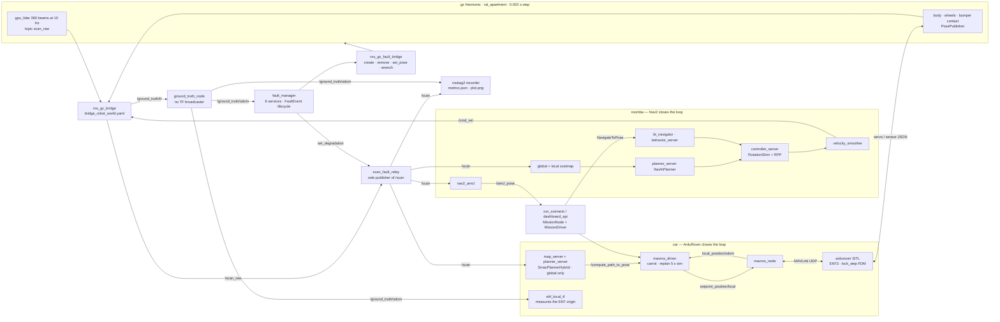
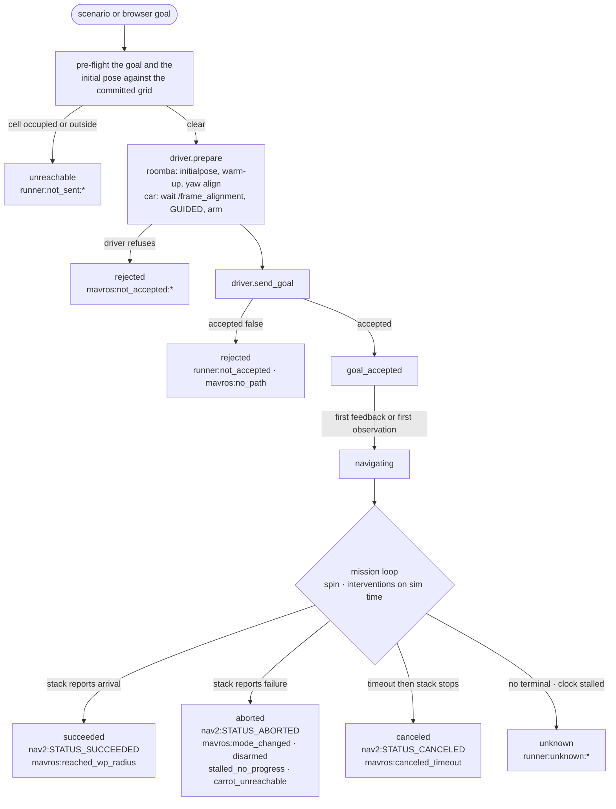

# Architecture

What a robotics engineer needs before reading the code: which processes exist,
which of them closes which loop, what frame and clock every number is in, where
the truth boundary is drawn and how it is enforced, and where a fault actually
enters the system.

Two robots, one world, one simulator. Nothing is shared between the platforms
except the simulator, the world, the fault manager and the evaluation side —
and the one file per platform that decides all three:
`ros2_ws/src/ral_bringup/config/robots/<robot>.yaml`.

Every number below is cited to the file or the measured document it came from.
Where something is not modelled or not measured, section 9 says so.

---

## 1. System map

### 1.1 What runs where

The host has no ROS. Everything ROS-side runs inside one image, `ral:dev`,
entered through `scripts/dev.sh` (`--network host --ipc=host`, `--user
$(id -u):$(id -g)`, `/dev/dri` passed through for ogre2). The host joins the
container's DDS graph for `rviz2` and the `ros2` CLI — that is the whole reason
for `--network host` (`scripts/dev.sh:7-13`, and the four discovery defects that
forced it are in [`gate.md`](gate.md) "Four defects found and fixed").

| Runs on the host | Runs inside `ral:dev` |
| --- | --- |
| `scripts/*.sh` wrappers, `docker`, the `flock`, image-ref resolution (`docker` is not available in the container, so `env.json` would otherwise record `unknown` — `scripts/run_scenario.sh:11-13`) | gz Harmonic, `ros_gz_bridge`, Nav2, `ardurover` SITL, MAVROS, `ral_faults`, `ral_eval`, the dashboard gateway, `colcon` |
| `rviz2` (the image is `ros:humble-ros-base-jammy` and has no rviz2 — `roomba_nav.launch.py:44-47`) | the rosbag recorder, `metrics.py`, `plot_run.py` |
| the browser | the static dashboard bundle, served by the gateway |

**One owner per ROS domain.** `scripts/run_scenario.sh:36-41` and
`scripts/dashboard.sh:23-27` take the *same* `flock` on
`/tmp/ral-run-$ROS_DOMAIN_ID.lock`. The stack owns fixed topic names and a
single gz server, so a second owner would drive the same robot
(`run_scenario.py:67-73`).

### 1.2 The robot profile is the switch

`ral_bringup/config/robots/<robot>.yaml` is the single source for the gz model
name, the spawn pose, the stack launch file, the bridge config, **what the
robot's position estimate is**, the plant limits, the footprint, which faults
are real for it, which topics a run records and which topics gate bring-up.
`ral_eval/robot_profile.py` is the only loader; it validates a **closed**
schema and raises on a missing key rather than defaulting — an absent key would
otherwise address the wrong gz entity, label a metric with an estimator that did
not produce it, or subject a platform to a fault nobody declared
(`robot_profile.py:43-48`, `97-199`).

The loader lives in `ral_eval` and the profiles live in `ral_bringup` because
`ral_bringup` exec-depends both `ral_eval` and `ral_faults`, `ral_faults`
depends on `ral_eval`, and `ral_eval` depends on neither; the reverse edge
closes a cycle colcon refuses to order (`robot_profile.py:29-41`). The
consequence is a rule: the loader never resolves `ral_bringup`'s share
directory — launch files pass the path
(`faults.launch.py:106-111`).

### 1.3 Processes per robot



Launch files: `robot_sim.launch.py` (gz, bridge, `robot_state_publisher`,
runtime spawn, `ground_truth_node`) is included by both
`roomba_nav.launch.py` and `car_nav.launch.py`; `faults.launch.py` (relay,
manager, second bridge) likewise. The body is **spawned at runtime** through
`/world/<world>/create` rather than included in the world SDF, so the car
standing in the Roomba's lidar cannot invalidate the committed map
(`robot_sim.launch.py:31-34`).

---

## 2. The two autonomy stacks side by side

| | `ral_roomba` | `ral_car` |
| --- | --- | --- |
| Profile | `config/robots/roomba.yaml` | `config/robots/car.yaml` |
| Body | DiffDrive, 0.18 m disc, `max_linear_velocity` 0.46 m/s, `max_angular_velocity` 1.9 rad/s (`ral_roomba/model.sdf:285-302`) | Ackermann, 0.50 × 0.30 m box, 0.611 m minimum radius (wheelbase 0.35 / tan 0.52), cannot rotate in place (`car.yaml:211-230`) |
| Actuation path | `gz-sim-diff-drive-system`, commanded on `/model/ral_roomba/cmd_vel` through the bridge | `ArduPilotPlugin`: steer knuckles on **channel 0** (POSITION, multiplier −1.04), both rear wheels on **channel 2** (VELOCITY, multiplier 70) (`ral_car/model.sdf:579-643`) |
| Global planner | `planner_server` / `GridBased` = `nav2_navfn_planner/NavfnPlanner`, tolerance tightened from upstream 0.5 (`nav2_roomba.yaml:405-410`) | `planner_server` / `CarHybrid` = `nav2_smac_planner/SmacPlannerHybrid`, DUBIN, `minimum_turning_radius: 0.611`, `angle_quantization_bins: 72`, `max_planning_time: 5.0` (`nav2_car.yaml:35-69`) |
| Local controller | `controller_server` / `FollowPath` = `RotationShimController` wrapping `RegulatedPurePursuitController` (`nav2_roomba.yaml:230-232`) | **none.** `nav2_car.yaml:10-16` states the omission: ArduRover *is* the controller, and a local costmap would bind to a MAVROS NED alias named `odom` |
| Costmaps | global + local, `robot_radius: 0.18`, `inflation_radius: 0.45`, `obstacle_layer` on `/scan` (`nav2_roomba.yaml:303-383`) | global only, **footprint polygon** `[[0.25,0.15],[0.25,-0.15],[-0.25,-0.15],[-0.25,0.15]]` — the 0.292 m circumscribed disc would refuse every 0.70 m doorway — `obstacle_layer` on `/scan`, `inflation_radius: 0.45` (`nav2_car.yaml:71-113`) |
| Recoveries | `behavior_server`: Spin, BackUp, DriveOnHeading, Wait, AssistedTeleop (`nav2_roomba.yaml:430-439`) | none |
| Localization | `nav2_amcl` over `/scan`, `update_min_d` 0.1 / `update_min_a` 0.2 (`nav2_roomba.yaml:75-80`) | ArduPilot EKF3 inside the firmware, read over MAVROS |
| Command | velocity twist `/cmd_vel`, published by `velocity_smoother`, `max_velocity: [0.40, 0.0, 1.5]` (`nav2_roomba.yaml:481`) | `SET_POSITION_TARGET_LOCAL_NED` on `/mavros/setpoint_position/local` |
| **Where the control loop closes** | inside Nav2: `controller_server` at `controller_frequency: 20.0` on the costmap + AMCL pose (`nav2_roomba.yaml:168`), output through `velocity_smoother` to the plant | inside the autopilot: ArduRover's own steering and throttle loop, stepped in lockstep with the physics at `SIM_RATE_HZ 500` ([`gate.md`](gate.md) "Lockstep"), on EKF3's estimate |
| What the ROS side does between control ticks | nothing — Nav2 owns it end to end | `mavros_driver.spin_once()`: republishes the setpoint every **0.1 s wall** (ArduPilot stops a guided vehicle after 3 s of setpoint silence, so the period must be wall, not sim — `mavros_driver.py:87-90`), advances the pure-pursuit carrot, replans every **5 s sim**, runs the no-progress supervisor |
| Reactive avoidance | costmaps + Nav2 recoveries | **none.** Between replans the autopilot steers straight at its current setpoint (`car.yaml:203-207`) |
| Supported interventions | 6 of 6 | 6 of 6, with a caveat the profile publishes verbatim: `/scan` reaches this platform's **global costmap only** (`nav2_car.yaml:88-104`), never ArduRover's control loop, so a lidar fault can change the route and cannot change how the route is tracked (`car.yaml`'s `scan_note`) |

### 2.1 The car's carrot, and why it is not a controller

`MavrosGuidedDriver` is not a local controller and is not described as one. It
is a **setpoint selector** with four measured constraints, all in
`car.yaml`'s `command:` block and all enforced in
`mavros_driver.py:704-828`:

- `waypoint_spacing_m: 1.0` — longer than the 0.611 m turning radius, so each
  leg is executable.
- `waypoint_lookahead_m: 2.0` — a carrot 2 m **along the path**, not in
  straight-line distance. Straight-line selection put the carrot across a wall
  as soon as the path turned (`car.yaml:168-170`).
- `waypoint_corridor_m: 0.2` — the chord the autopilot will actually drive must
  stay within 0.2 m of the planned path. Reachability may overrun the lookahead;
  it may never overrun the corridor (`mavros_driver.py:769-774`).
- `waypoint_radius_margin: 1.15` — `carrot_unreachable()`
  (`mavros_driver.py:123-158`) refuses a candidate inside either minimum-radius
  circle tangent to the nose, because pure pursuit would demand an arc this body
  is geometrically forbidden from driving. If nothing is admissible the driver
  **publishes no setpoint**, forces a replan from the current pose
  (`_force_replan`), and after `UNREACHABLE_GIVE_UP_SIM = 15.0` s sim ends the
  mission `mavros:carrot_unreachable`.

The before/after measurement for the reachability check is
[`engineering-log.md`](engineering-log.md) §3.

---

## 3. Coordinate frames and time

### 3.1 The frames

| Frame | Established by | Who owns the link into it | Present for |
| --- | --- | --- | --- |
| `world` | the gz world SDF origin | gz | both. Scenario poses, spawn poses, obstacle and kidnap poses, and ground truth are all in `world` |
| `map` | `slam_toolbox` at mapping start, sealed into `maps/apartment_frames.yaml` | `nav2_amcl` publishes `map -> odom` (roomba); `ekf_local_tf` publishes `map -> ekf_local` (car) | both. Every metric is scored here |
| `odom` | the gz DiffDrive bridge | `ros_gz_bridge` (roomba) | roomba. On the **car** the only frame named `odom` is a MAVROS NED alias, which is why `nav2_car.yaml` ships no local costmap (`nav2_car.yaml:13-16`) |
| `base_link` | the model SDF root link | DiffDrive bridge / `ekf_local_tf` | both |
| `ekf_local` | ArduPilot EKF3 at its **first GPS fix** | `ekf_local_tf` | car only |
| `base_link_truth` | `ground_truth_node` | **nobody** — it exists in no TF tree by design, so a TF listener pointed at it fails loudly (`ground_truth_node.py:53-61`) | both |

Observed TF frame sets, asserted by check 5 of each harness:
roomba — `base_link, caster_front, caster_rear, left_wheel, map, odom,
right_wheel, rplidar_link, world` ([`nav-closed-loop.md`](nav-closed-loop.md));
car — adds `base_link_frd, ekf_local, map_ned, odom_ned` and the steer/wheel
links ([`car-closed-loop.md`](car-closed-loop.md)). Both lists are closed:
anything unexpected fails, **including truth bridged onto `/tf` under any name**.

### 3.2 `world_to_map`: measured once, sealed to a grid hash

`world_to_map` is the pose of the `map` frame **origin** in `world`.
`slam_toolbox` registers its first scan at that scan's *odometric* pose, so
`map -> odom` starts as identity and `map` lands on the odom frame origin —
which, for a robot that has not moved since it spawned, is also its true pose
(`frames.py:16-31`). `capture_world_to_map.py` measures it there and checks
*both* halves of that coincidence, refusing with distinct exit codes if the
robot moved (2), no map arrived (3), or `/odom` was not at its origin (4)
(`capture_world_to_map.py:31-48`).

The committed value is `x: 0.5, y: 0.5, yaw: 0.0`, captured 2026-10-22T15:32:41Z
at git `a4c4354`, with `map_sha256: 47d1e2ad01a41a52…`
(`ral_bringup/maps/apartment_frames.yaml`).

`frames.load_alignment_for_map()` refuses an alignment whose recorded
`map_sha256` does not hash-match the `.pgm` beside it
(`frames.py:116-152`). A new grid beside an old alignment is the one failure
mode an alignment cannot survive and nothing else can detect: it offsets truth
from the estimate by a constant that reads as localization error in a stack that
is otherwise working. `load_world_to_map` has **no identity default** for the
same reason (`frames.py:70-72`).

`frames.py` has exactly one implementation and three importers (the launch
layer's display-only `map -> world` TF, the capture node, and `metrics.py`).
The proof harnesses under `scripts/checks/` deliberately **do not** import it
and re-derive the same arithmetic inline, because a verifier that imports the
code under test shares its bugs (`frames.py:36-38`).

### 3.3 The EKF origin: a per-run measurement, not a constant

ArduPilot sets its EKF origin at the autopilot's first GPS fix, so the offset
between `world` and the ENU frame `/mavros/local_position/*` reports in is a
**per-run measurement**. `ekf_local_tf.py` makes it once while the vehicle is
still standing at its spawn pose, publishes it latched on `/frame_alignment`
with its residual, and thereafter broadcasts `map -> ekf_local` (static,
measured) and `ekf_local -> base_link` (the robot's own estimate, every message).

It refuses rather than fudging, with four exit codes: the robot moved (2),
position residual over limit (3), no estimate at all (4), **yaw** residual over
limit (5). Both halves are checked because an unchecked yaw offset rotates the
whole estimate track about the origin and reads downstream as estimator drift —
and this platform's known failure mode, an inverted magnetometer, is exactly a
yaw error that leaves the position residual untouched
(`ekf_local_tf.py:36-61`). The committed limit is 0.10 rad because the measured
value on the baseline runs is 0.045 rad.

Check 6 of [`car-closed-loop.md`](car-closed-loop.md) re-derives the offset from
the harness's own first stationary truth and estimate samples and compares:
`world -> ekf_local` published at `(0.9990, 3.9989, 0.0455)`, harness-derived
identical, difference **0.0000 m / 0.0000 rad** against limits 0.05 m / 0.02 rad.

NED vs ENU is handled where it belongs: `ArduPilotPlugin` carries the two
rotation blocks ArduPilot requires (`ral_car/model.sdf:507-511`), MAVROS
republishes `LOCAL_POSITION_NED` as ENU odometry, and the driver converts `map`
poses into the autopilot's frame through the **measured** alignment
(`mavros_driver.py:671-688`). Without `/frame_alignment` the driver *refuses*
rather than assuming the frames coincide (`mavros_driver.py:53-57`).

### 3.4 Time

Every node runs `use_sim_time: true`; every duration in a scenario and in the
artifacts is sim time off `/clock` (`run_scenario.py:35-41`). Wall deadlines
appear only as deadlock guards on things that happen *before or outside* the
simulation — process start-up, DDS discovery, the setpoint republication
ArduPilot paces in wall time — and every one of them is named as such in code.

The clock is the simulator's and the autopilot's at once: `ral_car` carries
`<lock_step>1</lock_step>` (`ral_car/model.sdf:515`), so gz advances only when
the autopilot has answered, with `SIM_RATE_HZ 500` pinned against
`max_step_size` 0.002 — one FDM frame per physics step
([`gate.md`](gate.md) "Lockstep with ArduPilot SITL"). The cost is that a
stalled FDM handshake stops the simulation outright rather than letting it
drift, which is how both car bring-up defects presented: `/clock` went silent.

Real-time factor is therefore a wall-clock property only. Measured 0.999–1.002
at the selected settings (`gate.md` row 1), 0.79–1.01 under lockstep depending
on host load. `run_scenario` records `rtf_samples` per run; the mission loop's
wall guard (`timeout_sec * 10 + 120`) can only fire when `/clock` has actually
stopped, and produces the explicit outcome `runner:unknown:clock_stalled`
(`run_scenario.py:1109-1115`, `1166-1172`).

---

## 4. State estimation and the truth boundary

### 4.1 What is an estimate

| | roomba | car |
| --- | --- | --- |
| Estimate topic | `/amcl_pose` (`PoseWithCovarianceStamped`, frame `map`) | `/mavros/local_position/odom` (`Odometry`, frame **`ekf_local`**) |
| Uncertainty | `covariance_trace`, `converged_below: 0.25` | `estimator_status` — and the platform publishes **no numeric pose uncertainty at all** |
| Label carried into every metric | "AMCL (nav2_amcl) over /scan" | "ArduPilot EKF3 via MAVROS (LOCAL_POSITION_NED)" |

Both labels come from the profile, not from a module constant, so every
truth-vs-estimate figure in `metrics.json` names the estimator it was measured
against (`roomba.yaml:29-33`).

The car's `null`s are stated, not zeroed: ArduPilot sends no
`LOCAL_POSITION_NED_COV`, this MAVROS republishes `ESTIMATOR_STATUS` as its
twelve flag bits only and drops `pos_horiz_accuracy`, and requesting
`ESTIMATOR_STATUS` at 2 Hz is *refused* by this ArduRover
(`MessageInterval_Response success=False`) — so the topic is in every bag with
zero messages (`car.yaml:123-138`). `est_cov_trace_max`,
`est_pos_horiz_accuracy_max_m` and `est_status_flags` are therefore `null` with
that reason attached (`metrics.py:1310-1440`).

### 4.2 What is truth, and who may touch it

`ground_truth_node.py` republishes the gz `PosePublisher` stream (bridged as
`/ground_truth/tf`) as `/ground_truth/odom`. The enforcement mechanism is an
absence: **there is no `TransformBroadcaster` anywhere in that file**, so a
component that wants truth has to ask for it by name on an auditable topic
rather than silently receiving it through TF (`ground_truth_node.py:18-23`).
Output frames are `world` / `base_link_truth`, deliberately not `map` /
`base_link`. The twist is a finite difference computed here, and when no valid
difference exists it is marked unknown with `twist.covariance[0] = -1` rather
than published as a zero that would read as "measured at rest".

Three nodes are allowed to subscribe, and each is justified:

| Consumer | Why it is legitimate |
| --- | --- |
| the proof harness (`roomba_nav_check` / `car_nav_check`) | it is the evaluator |
| `fault_manager` | it projects a **body-frame** wrench into the world frame, the only frame `ApplyLinkWrench` accepts, and tells the robot nothing (`fault_manager.py:71-77`) |
| `ekf_local_tf` (car only) | measuring a frame offset requires both sides of it; what it broadcasts afterwards is the robot's own EKF3 estimate composed with a fixed measured offset (`ekf_local_tf.py:28-34`) |

`scripts/checks/common.py:151-169` implements the check as an **allowlist**, not
a pattern scan: `TRUTH_SUBSCRIBER_ALLOWLIST` is `('roomba_nav_check',
'fault_manager')` and `('car_nav_check', 'fault_manager', 'ekf_local_tf')`
respectively. Any node outside it fails check 4, and a navigation node matching
`NAV_NODE_PATTERNS` is reported separately, because a navigation component
reading truth is a different failure from an undeclared one. The allowlist exists
because a pattern list once passed `fault_manager` silently
(`roomba_nav_check.py:548-553`).

`metrics.py` is the one place truth and estimate meet: truth arrives in `world`,
the estimate in whatever frame its profile declares, and every comparison applies
`world_to_map` (and, for the car, the per-run measured `world -> ekf_local`
first) — never an implicit identity (`metrics.py:43-48`).

### 4.3 Closing loops on the estimate, never on truth

- `Nav2Driver.prepare()` seeds `/initialpose`, rotates in place at 0.6 rad/s
  until the covariance trace falls below the profile's limit, keeps rotating for
  `AMCL_FLOOR_SAMPLE_SIM = 4.0` s so the start-pose residual is a mean rather
  than a single reading, then turns back to the scenario's declared yaw — **closing
  on `/amcl_pose`**. If AMCL is wrong about the heading the mission starts from
  the heading AMCL believes, and `run.json` records the residual it believed it
  had (`nav2_driver.py:218-228`).
- Non-convergence is **data, not a refusal**: a run that navigates badly because
  the filter never converged is a result (`nav2_driver.py:121-123`).
- The car's arrival gate and its no-progress supervisor both close on
  `/mavros/local_position/odom` and the setpoint this run published. Truth is
  never read (`mavros_driver.py:36`, `926-938`).

---

## 5. Fault injection

`ral_faults/config/fault_catalogue.yaml` is the single vocabulary: one block per
`FaultEvent.KIND_*` carrying `category`, `service`, `srv_type`,
`injection_point`, `target_rule`, `lifetime`, `cleared_by`, `alters_truth`,
`honesty_note` and `param_ranges`. `test_mission_vocabulary.py` pins it against
`run_scenario.DISPATCH`, `mission_node.injection_point()` and `FaultEvent.msg`'s
own constants, so a drift fails the build rather than a run
(`fault_catalogue.yaml:15-21`).

| Kind | Category | Injected at | Lifetime / cleared by | Changes truth |
| --- | --- | --- | --- | --- |
| `spawn_obstacle` | environment | `/world/<world>/create` (gz UserCommands) | keyed_set / `clear_obstacle` | yes |
| `clear_obstacle` | environment | `/world/<world>/remove` | oneshot / nothing | yes |
| `scan_degradation` | perception | **`scan_fault_relay`** (driver/transport level) | singleton / `self_disable` | no |
| `mobility_fault` | dynamics | `/world/<world>/wrench/persistent` (gz physics) | singleton / `self_disable` | yes |
| `kidnap` | state | `/world/<world>/set_pose` | oneshot / nothing | yes |
| `reposition` | state | `/world/<world>/set_pose` | oneshot / nothing | yes |

The gz side is reached through a second bridge node, `ros_gz_fault_bridge`,
carrying three services and two topics (`faults.launch.py:124-139`). The bridge
YAML schema carries topics only and a CLI argument cannot rename, which is why
the manager publishes on `/world/<world>/wrench/persistent` rather than a tidier
ROS name (`faults.launch.py:29-36`).

### 5.1 The `/scan` relay

`scan_fault_relay` is the **sole publisher of `/scan`**. Every lidar consumer —
AMCL, both Roomba costmaps, the car's global costmap, `slam_toolbox` during
mapping — reads `/scan`; only evaluation code reads `/scan_raw`
(`scan_fault_relay.py:16-21`). That is the whole reason the node exists: every
consumer is downstream of the injection point *by construction*, not by
convention.

With degradation off the received object is republished **unchanged** — the same
message, no restamping, no field rebuilding (`scan_fault_relay.py:25-34`). With
it on, a new `LaserScan` carries the same header, angles, times, `range_min`,
`range_max` and intensities, with only `ranges` replaced; `range_max` is
deliberately *not* rewritten to `max_range_m`, because moving it would tell every
consumer the hardware changed (`scan_fault_relay.py:36-41`).

The RNG is `random.Random(seed)`, reseeded on every enable, so the corrupted
stream is a function of (seed, scans since activation). `seed` comes from the
scenario. It governs the relay only — `nav2_amcl` exposes no seed
(`scan_fault_relay.py:53-60`).

### 5.2 How a platform refuses

`robot_profile.supports(profile, kind)` returns `None` when supported, otherwise
the refusal reason — **verbatim from the profile's `unsupported:` block** when
there is one, and a stated "silence in the table is not consent" message when
there is not (`robot_profile.py:211-228`). `fault_manager` is the only node that
applies the gate, publishes `FaultEvent(state=rejected)` with that text, and
never attempts the call (`fault_manager.py:32-36`).

No profile carries a populated `unsupported:` block today. The one that did —
`car.yaml`'s `scan_degradation` — was retired once the car's global planner
gave the lidar a real consumer; see [`engineering-log.md`](engineering-log.md)
§5 for the stale claim and the run that replaced it.

### 5.3 How an effect is measured, not asserted

`FaultEvent`'s four states exist specifically so a reader can tell a *request*
from an *effect* (`FaultEvent.msg:18-38`): `requested` is published **before**
the underlying call; `activated` only when that call returned success. What
"success" means is stated per kind rather than smoothed over — gz's own reply for
spawn/clear/kidnap, the relay's confirmation that parameters are in force for
scan degradation, and for the wrench, "the `EntityWrench` was published with the
gz bridge subscribed", because gz acknowledges a wrench publication with nothing
at all (`fault_manager.py:43-58`).

Two measured consequences worth knowing:

- **Wrench accumulation.** gz's `ApplyLinkWrench` keeps a *list* of persistent
  wrenches and applies every entry each step, so re-projecting a body-frame force
  as the robot turns would multiply it without bound and produce a dramatic, fake
  result. Every publication is preceded by a clear on
  `/world/<world>/wrench/clear` (`fault_manager.py:60-69`).
- **Effect is read from the bag, not from the event.**
  `metrics.scan_divergence()` compares `/scan` against `/scan_raw` **beam by beam
  on identical header stamps** and reports `pairs_matched`, divergence before and
  after activation, plus `pairs_unmatched` and `pairs_length_mismatch` — the
  sweeps that were *not* compared, whose absence a v3 file cannot distinguish from
  zero (`metrics.py:75-77`, `909-970`). `obstacle_min_clearance_m` is computed only
  inside the interval an obstacle actually existed, anchored on its `activated`
  stamp, and is `null` naming the missing anchor otherwise
  (`metrics.py:1974-1982`).

`mobility_fault`'s honesty note says what it is: "an external wrench on the base
link, not a degraded actuator… the wrench changes motion only once it exceeds
what the wheels can absorb" (`fault_catalogue.yaml:131-137`). The *deficit
ladder* is not in the catalogue, because what a wrench does depends on the plant:
each profile carries its own measured `mobility_note` and the manager publishes it
verbatim beside the shared one (`roomba.yaml:126-131`, `car.yaml:331-343`).

`reposition` differs from `kidnap` in exactly three stated ways, the third being
that the estimator is reseeded **only on a platform that exposes a seed**: the
Roomba's AMCL through `/initialpose`, while EKF3 is not seedable, so the car
reports `estimate_reseeded: false` and truth and estimate disagree by the move
distance until GPS pulls them back (`fault_catalogue.yaml:176-187`).

---

## 6. Mission lifecycle and terminal outcomes

### 6.1 One node, two drivers

`MissionNode` (`ral_eval/mission_node.py`) is the **one** ROS node a mission is
driven through, whoever is driving it: `run_scenario` for a scenario,
`dashboard_api` for an operator-issued mission. A `MissionDriver` is written
against `MissionNode`'s surface (`sim_now`, `spin_wall`, `spin_sim`, `stop`,
`cmd_pub`, `publish_initial_pose`, `amcl`, `converged_sim`, `wtm`, `grid`), not
against `rclpy.node.Node` — "a dashboard that reimplemented any part of it would
be driving a different robot than the harness measures"
(`mission_node.py:16-24`).

The split is deliberate: the runner owns `/mission_state` (single publisher), the
bag, the intervention schedule, the timeout and the artifacts; a driver owns only
*how* a goal is sent, monitored and stopped. Pretending Nav2's action and
ArduRover's setpoint stream are one interface "would mean inventing a status for
the platform that does not produce one" (`mission_driver.py:23-29`). `MissionNode`
creates `/initialpose` and `/cmd_vel` publishers **only** for a `velocity_twist`
platform, so the graph never shows a command path that does not exist
(`mission_node.py:138-149`).



### 6.2 The outcome vocabulary is closed and gated

`mission_driver.OUTCOMES` is the closed set, and
`MissionNode.publish_mission_state()` **raises** on a value outside it rather than
letting it reach a bag or a dashboard (`mission_node.py:237-250`). The prefix is
the *source*: `nav2:` values are literal `action_msgs/GoalStatus` constant names
(NavigateToPose's result payload is `std_msgs/Empty`, so the status code is the
only verbatim outcome the action offers); `mavros:` values are read from the
autopilot's own telemetry; `runner:` values are the ones no stack produced
(`MissionState.msg:65-76`). `test_mission_vocabulary.py` parses the comment block
out of the **installed** `.msg` and asserts it equals the Python tuple, so prose
and code are one artifact (`mission_driver.py:37-41`).

Two entries are templates: `nav2:unknown:status_<n>` and
`mavros:mode_changed:<MODE>`. `outcome_is_known()` expands them and rejects a bare
prefix (`mission_driver.py:89-103`).

`unreachable` is **pre-flight refusal only**. An in-flight failure is `aborted`,
because "Nav2 reports a status, not a cause, and calling an abort 'unreachable'
would be an inference dressed as a measurement" (`MissionState.msg:35-41`).

### 6.3 Arrival rules, per platform

| | roomba | car |
| --- | --- | --- |
| Who declares arrival | Nav2's `general_goal_checker` (`xy_goal_tolerance` tightened from upstream 0.25 so "goal reached" means reached — `nav2_roomba.yaml:194-199`), surfaced as a terminal `GoalStatus` | a **conjunction**, both halves the robot's own |
| Condition | `STATUS_SUCCEEDED` on the goal this run sent | `NAV_CONTROLLER_OUTPUT.wp_dist` within `goal_tolerance_m` (1.0 m, = `WP_RADIUS`) on `WP_DIST_HITS = 3` consecutive messages while mode is `GUIDED` and armed, **and** `|estimate − commanded setpoint|` within `arrival_estimate_tolerance_m` (0.6 m) |
| Guard | — | the FCU must first have reported a distance **beyond** tolerance. `wp_dist` is 0 whenever the autopilot has no active target and publishes at rest; without the guard a mission was declared reached at 0.0 s sim on the spawn pose (`mavros_driver.py:944-953`) |
| Why two halves | — | `wp_dist` is a `uint16` in **metres** and truncates, so a reported 1 means anywhere in [1, 2) and on its own cannot bound where the vehicle came to rest (`car.yaml:243-255`) |
| Also guarded | — | arrival is only arrival **at the goal**: with a planned path the setpoint is usually a carrot, and the same conjunction closes on every one of them. Measured failure without the `at_final` test: `mavros:reached_wp_radius` after 0.98 m of travel, 5.31 m from the goal (`mavros_driver.py:967-974`) |

### 6.4 The no-progress safe stop

`MavrosGuidedDriver._check_stall()` ends the mission `mavros:stalled_no_progress`
when the robot's own estimate moves less than `STALL_MIN_PROGRESS_M = 0.25` m
over `STALL_WINDOW_SIM_S = 15.0` s sim — well below anything this plant does
while driving, since 1.0 m/s cruise covers 15 m in that window
(`mavros_driver.py:92-96`). It commands `HOLD` and reports the distance it
measured.

It is labelled a **deterministic programmed policy, not autonomy**, everywhere it
appears (`mavros_driver.py:46-51`, `MissionState.msg:93-96`,
[`car-closed-loop.md`](car-closed-loop.md) known limitations). The reason it
exists is stated: ArduRover carries no obstacle avoidance and will push against a
wall until the scenario times out. Notably the proof harness **does not run it** —
"a harness that stopped the vehicle on its own schedule would be measuring its own
policy" — so an unfinished mission there is reported as "no terminal condition".

### 6.5 A browser mission is the same code path

`dashboard_api` imports `build_driver`, `MissionNode`, `goal_pose_stamped`,
`preflight_goal`, `DISPATCH`, `RECORD_TOPICS_COMMON`,
`RECORDER_GATE_TOPICS_COMMON`, `CANCEL_WAIT_SIM`, `POST_TERMINAL_SIM` and
`STACK_READY_WALL_LIMIT` **from `run_scenario` and `mission_driver` directly**
(`dashboard_api.py:74-98`) and runs the mission on a single worker thread that is
the only thread spinning `MissionNode` (`dashboard_api.py:41-43`). It writes a
run directory through the shared `run_artifacts.make_run_dir` /
`build_env` / `write_json` writers, with `experiment_id = f'ui_{robot}'`
(`dashboard_api.py:1895`, `2128-2132`), and ticking "record" adds the bag,
`metrics.json` and `plot.png` through the same `metrics.write_metrics` and
`plot_run.write_plot` (`dashboard_api.py:2296-2323`). The artifact writers are
shared rather than duplicated because `write_metrics` hard-depends on `env.json`'s
exact key set, and two assemblies of that dict would drift and break dashboard
runs only — "the runs nobody regenerates" (`run_artifacts.py:18-24`).

---

## 7. Evidence pipeline

```
scenarios/<id>.yaml
   └─ scenario.py       strict schema, refuses rather than repairs
       └─ run_scenario.run()
           ├─ launch <robot>_nav.launch.py        (bring-up gate: profile's bringup_topics)
           ├─ rosbag2 recorder                    (gate: the recorder's OWN subscriptions)
           ├─ MissionDriver.prepare / send_goal / spin_once / terminal
           └─ runs/<experiment_id>_<UTC>/
                 scenario.yaml  env.json  run.json  events.jsonl*
                 bag/  bag_record.log  launch.log  metrics.json  plot.png
```

**Scenario.** Pure Python, no rclpy, so the rejection cases are testable without
a ROS graph. One legal world; two legal robots; `INTERVENTION_PARAMS` is the
schema *and* the set `DISPATCH` must cover; `INTERVENTION_PARAM_RANGES` is pinned
against `fault_catalogue.yaml` by `test_fault_catalogue.py`
(`scenario.py:42-83`). The justification for the strictness is specific: falling
back to `ral_apartment` for an unknown world would score a run against a map that
does not belong to it, and every estimate-error number would be a frame offset
reported as localization error.

**Recorder gating.** `RECORDER_GATE_TOPICS_COMMON` plus the profile's
`recorder_gate_topics` name the topics whose **pre-mission history is evidence**.
`ros2 bag record` subscribes topic by topic after start-up; measured on this
machine the last subscription landed 5.6 s after the process started, and a fixed
3 s wait silently lost every `/initialpose` and the whole localization warm-up
(`run_scenario.py:253-265`). The runner now waits for the recorder's own
subscriptions to appear in the graph, and records any that never did.

**`env.json`** carries 29 keys (`run_artifacts.build_env`), including
`image_ref`, `git_sha` (suffixed `+dirty`), `git_dirty`, `git_diff_sha256`,
`map_sha256`, the **text** of the alignment file and of the robot profile,
`nav2_params_sha256`, `autopilot_parm_sha256`, `firmware_sha` (the ArduPilot
commit, from `/opt/ardupilot/VERSION.txt` written at image build, because
`docker/ardupilot.repos` pins a *branch*), `scenario_sha256`, `launch_command`
and `bag_qos_overrides_sha256`. The profile and alignment are stored as text
rather than by reference so a later edit cannot change what an old run claims to
be (`run_artifacts.py:177-182`).

**`metrics.json`.** Every metric is an object, never a bare number:

```
{"value": …, "unit": …, "source": …, "definition": …, "reason": …}
```

`value` is `null` **with a reason** whenever an input is missing. There is no
default and no zero-for-no-data — "0 collisions" and "collisions could not be
counted because /bumper is not in the bag" are different claims, and only one is
a measurement (`metrics.py:18-26`). `metric()` raises if a null arrives without a
reason (`metrics.py:246-251`). `METRICS_VERSION` is 6 and the bump history is in
the file header; `repeatability_report.py` refuses an older run against its own
`METRICS_VERSION_SUPPORTED`, so the version is load-bearing.

The metric set: `path_length_m` (teleports excluded and reported separately as
`teleport_excluded_m`), `goal_pose_error_m`, `est_error_mean_m`,
`est_error_max_m`, `est_error_at_start_pose_m`, `est_cov_trace_max`,
`est_pos_horiz_accuracy_max_m`, `est_status_flags`,
`localization_converged_sim_s`, `collision_count`, `plan_publications`,
`stopped_time_s`, `mission_result`, `recoveries`, `cmd_vs_achieved`,
`speed_vs_target`, `fault_to_response_s`, `obstacle_min_clearance_m`,
`scan_degradation_divergence`.

Three details a reviewer should check:

- **`collision_count: 0` is only a measurement if the path that would have
  carried a report is shown to exist.** The definition string carries a liveness
  proof: `/bumper`'s ROS publishers *and* the gz contact topic being listed by
  `gz topic -l` (`run_scenario.bumper_liveness`, `metrics.py:1498-1522`).
- **Fault-response detection is calibrated per run, not by a fixed threshold.**
  A fixed 0.05 m/s trigger with an unbounded forward search fired on 31 of 31
  synthetic instants in a run where no fault was ever applied. The thresholds are
  now derived from the run's own pre-activation window
  (`RESPONSE_BASELINE_WINDOW_S = 10.0`, `RESPONSE_BASELINE_MARGIN = 1.5`) and
  bounded to `RESPONSE_HORIZON_S = 2.0` s sim; `PLAN_DETECTION_RESOLUTION_S = 1.0`
  is reported beside the metric because the BT republishes `/plan` at 1 Hz
  regardless (`metrics.py:102-134`).
- **`bagio.py` is the one bag reader**, used by both `metrics.py` and
  `plot_run.py`, so the JSON and the figure cannot disagree about when something
  happened. It returns a per-topic *status* beside the samples, because an empty
  list cannot distinguish "not in the bag", "never published" and "message type
  could not be imported" — the third is live on any machine without `nav2_msgs`
  (`bagio.py:43-53`).

**`plot.png`** is a 2×2 figure (map, estimate error, commanded-vs-achieved,
event timeline) recomputed from the same bag over the same window through the
same functions; a panel with no data is drawn **empty with the reason written in
it**, because a missing panel looks like an oversight and a labelled empty one is
evidence (`plot_run.py:36-38`).

**The proof harnesses** under `scripts/checks/` are separate programs that launch
a stack, drive a mission and write their own document:
`roomba_nav_check.sh` → [`nav-closed-loop.md`](nav-closed-loop.md) (12 checks),
`car_nav_check.sh` → [`car-closed-loop.md`](car-closed-loop.md) (13 checks),
`repeatability_check.sh` → the two repeatability documents,
`roomba_teleop_check.sh` → [`roomba-teleop-loop.md`](roomba-teleop-loop.md),
`scripts/gate.sh` → [`gate.md`](gate.md). `map_sanity.py` checks the map against
the world SDF and is what seals `map_sha256` into the alignment file.

They deliberately do **not** import `ral_eval.frames` or `ral_eval.scenario`;
`car_nav_check.py` re-implements `MavrosGuidedDriver`'s arrival rule rather than
importing it ([`car-closed-loop.md`](car-closed-loop.md) lines 20-27). The
scenario runner, by contrast, *does* import them: it is production code, and
there must be exactly one conversion and one schema in the thing being run
(`run_scenario.py:96-99`).

`run_scenario.py:101-136` records four **negative controls** — mutations applied
to make the runner fail, with the observed failure — including one that *failed
to fail* (deleting the bag QoS overrides did not empty the bag, because rosbag2
adapts to the publisher's QoS) and whose incorrect claim was then corrected
everywhere it appeared.

Exit codes separate "the experiment ran and was measured" (0, even for an abort
or a refusal) from "the evidence is not there" (4, bag missing or short of the
pinned latched topics) (`run_scenario.py:43-56`).

---

## 8. Dashboard architecture

### 8.1 Threading

`dashboard_api.py` is one long-lived process that **outlives any stack it
starts** — it launches and stops them, so it cannot be started by a stack launch
file (`scripts/dashboard.sh:7-10`). The thread split is fixed and documented as
"breaking this is how two spinners end up on one node"
(`dashboard_api.py:35-46`):

| Thread | Owns | Spins |
| --- | --- | --- |
| `telemetry` | `TelemetryNode` + a `SingleThreadedExecutor` | `TelemetryNode`, exclusively |
| `http` | `ThreadingHTTPServer` | nothing; polls `future.done()` at 10 ms |
| `worker` (one at a time) | `MissionNode` and the `MissionDriver` | `MissionNode`, exclusively |
| `rtf` | — | polls `run_scenario.measure_rtf(world)` every 10 s |

`MissionNode` is never added to the telemetry executor. A gateway `_epoch`
counter means a worker may only write state for the epoch it was started in,
so a bring-up abandoned by a stop cannot write `ready` over an idle gateway
minutes later (`dashboard_api.py:1185-1189`).

### 8.2 HTTP and SSE surface

GET `/api/stream` (SSE), `/api/reference`, `/api/map`, `/api/stack`,
`/api/stack/log`, `/api/runs`, `/api/runs/<id>[/plot.png]`; POST
`/api/stack/start|stop`, `/api/mission/start|cancel`, `/api/faults/<kind>`
(`dashboard_api.py:2467-2521`).

SSE topics and their encoders, one per message type:
`truth`, `est`, `scan`, `scan_raw`, `plan`, `cmd`, `fb`, `wp`, `mavros_state`,
`align`, `bumper`, `mission`, `fault_event`, `active`, `map`, `costmap`,
`clock`, plus the gateway's own `stack`, `rtf`, `hello`, `dropped`, `reset`.
Which of them a stack produces is decided by the profile, not by the robot name:
`/plan` and `/map` are subscribed "for whatever plans", the costmap and action
feedback only for a `velocity_twist` platform, and the MAVROS topics only for
`mission_driver == 'mavros_guided'` (`dashboard_api.py:651-685`).

`RATE_LIMIT_S` throttles *sampled streams only* (truth 20 Hz, scan 10 Hz = the
sensor's own rate, map/costmap 1 Hz); `NEVER_DROP` covers every event topic,
because a dropped event is a hole in the record. On backlog overflow
(`CLIENT_QUEUE_MAX = 256`) the oldest rate-limited frame is dropped **and a
`dropped` frame is sent**, so the console can hatch the gap rather than
interpolate across it (`dashboard_api.py:127-147`).

### 8.3 The view-model boundary

The encoders transcode and never interpret (`dashboard_api.py:18-23`). Typed in
TypeScript in `dashboard/src/client/types.ts`, whose header states the rule:
"Every `| null` here is load-bearing: null means the robot did not report the
value, and the UI must say so rather than draw a zero." Examples that matter —
`EstimateMsg.covariance_trace: number | null` for the platform that publishes
none; `ScanMsg.ranges: (number | null)[]` where null is explicitly a no-return;
`CmdMsg.stamp_source: 'received'` because `Twist` is unstamped;
`WpMsg.wp_dist` documented in the type as "uint16 METRES, truncating".

`dashboard/src/client/source.ts` defines one interface, `RalSource`, with two
implementations — `liveSource` (SSE + POST) and `mockSource` (a fixture). They
publish the **same** view model, "which is the only reason a mock is admissible
at all: the console cannot tell them apart, so it cannot grow a code path that
only works against made-up data". `kind: 'live' | 'mock'` exists so the UI can
*say* which it is showing, and replay controls appear only in mock mode
(`source.ts:3-13`). `store.ts` ingests `(topic, payload)` identically from either.

`build_reference()` (`dashboard_api.py:1104-1143`) returns everything the UI must
not hardcode — the fault catalogue verbatim, every robot profile, the map's
resolution/size/origin/thresholds/`map_sha256`, the measured `world_to_map`, the
world geometry and the installed scenario list. There is no world selector,
because "a selector whose other entries do not exist would be a control that
cannot be honoured" (`dashboard_api.py:112-115`).

### 8.4 The link is not a robotics protocol

JSON over SSE + POST, labelled "dashboard link" everywhere it is shown, so nobody
reads it as a telemetry bus (`dashboard_api.py:18-20`,
[`engineering-log.md`](engineering-log.md) §6.2). `liveSource.ts:4-10` says the
same from the browser side: `link` is synthesised there and nowhere else — it is
the browser's view of the `EventSource`, not a robotics signal — and when it
drops the console marks a gap rather than interpolating or silently ageing a
value. This is `ENGINEERING.md` §7: do not mislabel application-level dashboard
communication as a robotics protocol implementation. MAVLink is used where it
belongs, on the autopilot, and nowhere else.

---

## 9. Where the seams are

The honest list, each item cross-linked to the measurement that establishes it.

**Not modelled**

- **The car has no local controller and no reactive avoidance.** It plans
  globally and follows the plan in open space; the limit is tracking accuracy
  against clearance — 0.45 m of planner inflation, a 0.9 m doorway, a 0.30 m body,
  and the measured cross-track error of a straight-line GUIDED follower consumes
  what is left (`car.yaml:79-86`, [`engineering-log.md`](engineering-log.md) §2).
- **The car's steering is parallel, not Ackermann**, and both rear wheels share
  `ArduPilotPlugin` channel 2, so there is no differential
  (`ral_car/model.sdf:579-643`, `car.yaml:217-230`). Both cost tyre scrub in
  tight turns. What the claims rest on survives: non-holonomic, finite 0.611 m
  radius, cannot rotate in place.
- **The lidar does not reach ArduRover's control loop.** It is bridged, relayed
  and recorded so the sensor gate covers both robots identically
  ([`car-closed-loop.md`](car-closed-loop.md) known limitations).
- **`reposition` cannot reseed EKF3** — no seeding interface exists over MAVROS,
  so the event reports `estimate_reseeded: false`
  ([`engineering-log.md`](engineering-log.md) §5).
- **Lidar degradation is a transport-level corruption, not a sick sensor.**
  Gazebo Harmonic cannot change SDF sensor noise at runtime, and that sentence is
  repeated verbatim in the catalogue, the node docstring and the scenario
  (`fault_catalogue.yaml:104-107`).
- **One robot per experiment.** No fleet coordination, no hardware in the loop.
- **One world.** A second world needs its own bridge config (three gz topic paths
  embed the world name), its own `slam_toolbox` map and its own alignment
  (`scenario.py:42-46`).

**Not measured, or measured only as a floor**

- **The map carries real SLAM error by design** — built from one mapping drive,
  not rasterised from the world SDF. The stationary residual, 0.1277 m, is the
  floor under every estimate-error number here, and it mixes map error, alignment
  error and AMCL's own error with nothing separating them
  ([`nav-closed-loop.md`](nav-closed-loop.md) check 6 and known limitations).
- **The car publishes no numeric pose uncertainty at all** — see §4.1. Three
  metrics are permanently `null` on that platform, each naming why.
- **Check 9's turning radius is a lower bound for one mission**, not a plant
  limit: `min(speed / |yaw rate|)` over one run's truth samples, 34.263 m there,
  against a geometric 0.611 m ([`car-closed-loop.md`](car-closed-loop.md)).
- **Neither estimator is seedable.** `nav2_amcl` draws from `drand48`; EKF3 fuses
  inside the firmware. `seed:` governs the scan relay's RNG only. The spread is
  published as a property of the system:
  [`repeatability-baseline_roomba.md`](repeatability-baseline_roomba.md) (1.5 %
  on `mission_duration_s` over 3 runs) and
  [`repeatability-baseline_car.md`](repeatability-baseline_car.md) (165 %, with a
  named cause).
- **The car's estimate stream can stall mid-mission and then flush.** MAVROS
  delivers `/mavros/local_position/odom` from a link the simulation does not pace;
  measured gaps of 0.14 / 2.88 / 2.59 s inside the mission window across three
  runs. `est_error_*` pairs by header stamp, so a flush reports metres of "error"
  the estimator never had — `goal_pose_error_m` is measured from truth alone and
  is unaffected, so the two columns disagreeing is the signature. The real
  consequence is not the metric: while the stream is stalled both the arrival gate
  and the no-progress supervisor close on a stale pose
  ([`repeatability-baseline_car.md`](repeatability-baseline_car.md)).
- **The GPU-vs-software rendering margin is unmeasured** beyond the Phase 0 scene,
  where the gate did not discriminate between them ([`gate.md`](gate.md)).

**Deliberately a policy, not autonomy**

- The car's no-progress safe stop (§6.4). It is the scenario runner's, not the
  robot's, and it is labelled that way in the message definition, the driver, and
  the measured document.

---

## Reading order for the code

1. `ros2_ws/src/ral_bringup/config/robots/roomba.yaml` and `car.yaml` — every
   platform difference in two files.
2. `ros2_ws/src/ral_eval/ral_eval/mission_driver.py` — the outcome vocabulary and
   the driver contract, 232 lines.
3. `ros2_ws/src/ral_eval/ral_eval/mission_node.py` — the one node both producers
   drive.
4. `ros2_ws/src/ral_eval/ral_eval/nav2_driver.py` then `mavros_driver.py` — the
   two stacks' mission execution.
5. `ros2_ws/src/ral_eval/ral_eval/frames.py` and `ekf_local_tf.py` — the frame
   story end to end.
6. `ros2_ws/src/ral_faults/config/fault_catalogue.yaml` then
   `ral_faults/fault_manager.py` and `scan_fault_relay.py`.
7. `ros2_ws/src/ral_eval/ral_eval/metrics.py` header, then any single metric.

The suite needs no simulator and runs in the same image —
`scripts/dev.sh bash -lc 'cd /ws/ros2_ws && colcon test && colcon test-result'`
— **272 tests, 0 failures**, measured 2026-11-05 ([`../README.md`](../README.md)).
It includes `ral_bringup/test/test_nav2_contract.py`, which asserts that the
velocity and acceleration overrides this plant depends on are in force rather
than merely present in a YAML file.
